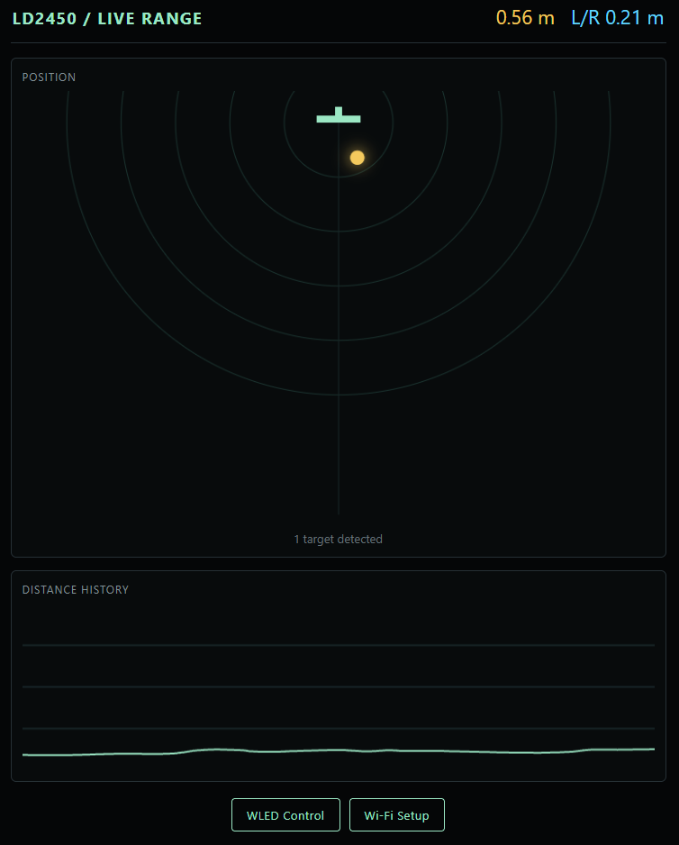
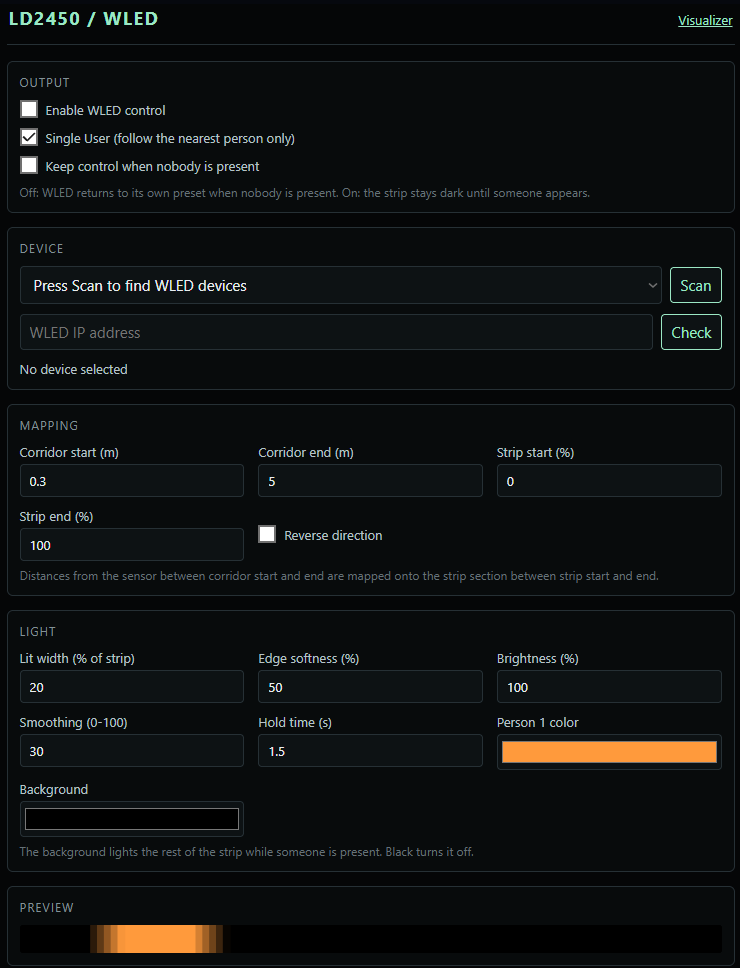

# LD2450 distance reader

** This is an incomplete work in progress **

- This is built for an ESP8266 device like the Wemos D1 Mini, and a LD2450 Microwave presence sensor.
- The firmware reads the tracked targets from an LD2450 connected to the ESP and converts the data to user-friendly values.
- The device also serves a website with a visualization of the sensor and position of tracked people.
- It can track up to 3 people in two axis and up to ~7m away.
- An optional integration with a WLED Devices allows controling a LED strip of a separate WLED device over wifi.
- Conceived for a dynamic corridor light that follows the people as they walk.

- next update MQTT integration for compatibility with Home Assistant. 




## Wiring

Use a common ground and connect:

| LD2450 | Wemos D1 mini |
| --- | --- |
| TX | D7 (GPIO13) |
| RX | D8 (GPIO15) |
| GND | G |
| VCC | 5V |

The LD2450 UART is 3.3 V logic. Power the sensor according to the specific board's documentation, and do not connect a 5 V UART signal to the D1 mini.

## Build and monitor

1. Open this folder in VS Code with PlatformIO installed.
2. Build and upload the `d1_mini` environment. (or change to your board)
3. Open the serial monitor at `115200` baud.


## Wi-Fi Visualizer 

On startup, the device first tries saved home Wi-Fi credentials without opening a setup portal. If it cannot connect, it creates an access point named `LD2450-Visualizer`; connect to it and the phone should offer to sign in to the network, which opens the visualizer. Otherwise open `http://192.168.4.1`. The visualizer page includes a `Wi-Fi setup` link that opens the WiFi Setup. 
After saving credentials the device restarts and joins that network; if it cannot connect, it falls back to the `LD2450-Visualizer` access point.

When connected to home Wi-Fi, use `http://ld2450.local` or the device IP address shown by your router or the serial monitor.

If Chrome on Android cannot open the page (for example `ERR_TOO_MANY_RETRIES`) while other browsers can, allow Chrome's `Nearby devices` permission in Android Settings > Apps > Chrome > Permissions. Recent Android versions block local network access without it.

## WLED control



The `WLED Control` page (`http://ld2450.local/wled`) lets the sensor drive an LED strip on a separate WLED device running stock firmware, so a lit section of the strip follows people along a corridor.

- **Device:** press `Scan` to find WLED devices on the network (mDNS `_wled._tcp`), or enter an IP address and press `Check`. The LED count is read from the device's `/json/info`, so all strip settings are percentages.
- **Single User** (on by default): follow only the nearest person. When off, each of the three tracked people gets their own window and color.
- **Keep control when nobody is present** (off by default): when off, WLED returns to its own preset as soon as nobody is present. When on, the strip stays dark until someone appears. In both cases the sensor stops sending packets while nobody is present.
- **Mapping:** the corridor start/end distances from the sensor are mapped onto the strip start/end percentages. `Reverse direction` flips which end of the strip is nearest the sensor.
- **Light:** lit width, edge softness, brightness, smoothing, hold time after someone is lost, a color per person, and an optional background color for the rest of the strip while someone is present.

Frames are sent with WLED's realtime UDP protocol (DNRGB, port 21324) at up to 30 per second, and only when the picture changes. In WLED, `Receive UDP realtime` must be enabled under `Config > Sync Interfaces` (it is by default). Settings are stored in flash and survive a restart.

## Serial log

The serial monitor shows startup, Wi-Fi and web request messages, for example:

```text
LD2450 boot, reset reason: External System
Connected to HomeWifi, http://192.168.1.222 or http://ld2450.local
Web server started
HTTP GET / from 192.168.1.41
```

A short burst of unreadable characters at power-up is the ESP8266 boot ROM, which always prints at 74880 baud.

The sensor's default UART speed is 256000 baud. The sketch uses the D1 mini's hardware UART permanently on D7/D8. A separate transmit-only software serial channel sends log output through the normal USB serial TX pin, so the monitor remains at 115200 without interrupting sensor reception.

The sketch parses the LD2450 detection frame (`AA FF 03 00 ... 55 CC`) and tracks up to three targets. The web visualizer shows a colored dot for each active target, and its fixed distance readout and history graph use the nearest target. A zero distance means no target is currently detected.

The LD2450 reports a 2D position for each target, not only a distance. `x_mm` is the target's left/right position relative to the sensor, and `y_mm` is its position along the sensor's forward axis. The display uses the LD2450's native lateral convention. The reported distance is calculated from those coordinates. Coordinates use a sign bit, which the sketch decodes before calculating the distance.