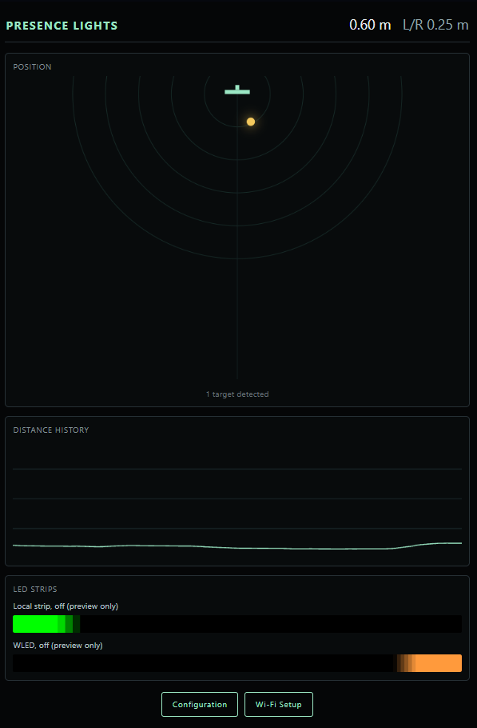
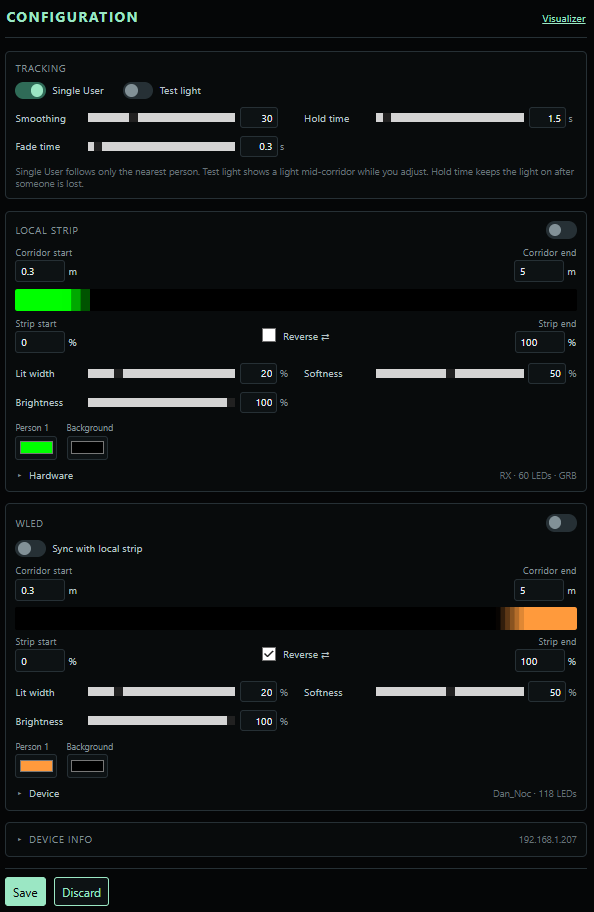

# LD2450 distance reader

** This is an incomplete work in progress **

- This is built for an ESP8266 device like the Wemos D1 Mini, and a LD2450 Microwave presence sensor.
- Allows control of a LED strip relative to the person position.
- The firmware reads the tracked targets from an LD2450 connected to the ESP and converts the data to user-friendly values.
- The device also serves a website with a visualization of the sensor and position of tracked people.
- It can track up to 3 people in two axis and up to ~7m away.
- A WS2812 LED strip can be connected directly to the device, alone or together with WLED.
- An optional integration with a WLED Devices allows controling a LED strip of a separate WLED device over wifi.
- Conceived for a dynamic corridor light that follows the people as they walk.

- next update MQTT integration for compatibility with Home Assistant. 




## Wiring

Use a common ground and connect:

| LD2450 | Wemos D1 mini |
| --- | --- |
| TX | D7 (GPIO13) |
| RX | D8 (GPIO15) |
| GND | G |
| VCC | 5V |

The LD2450 UART is 3.3 V logic. Power the sensor according to the specific board's documentation, and do not connect a 5 V UART signal to the D1 mini.

### Local LED strip (optional)

| WS2812 strip | Wemos D1 mini |
| --- | --- |
| DIN | RX (GPIO3, recommended) or D4 (GPIO2) |
| GND | G, and the strip power supply's ground |
| 5V | Strip power supply only |

Only these two pins are supported, because the ESP8266 sends them with hardware (I2S DMA on RX, UART1 on D4). Other pins would need bit-banging with interrupts disabled, which drops sensor data. On D4 the D1 mini's onboard LED flickers with the data.

Power the strip from its own 5 V supply sized for the strip, not from the D1 mini's 5V pin. The 3.3 V data signal usually works over a short wire; for reliability use a level shifter (for example 74AHCT125).

**Alternative: diode on the first LED.** Running the first LED at about 4.3 V lowers its input threshold enough to read the 3.3 V signal, and it passes the data on at a level the rest of the strip reads reliably.

1. Cut the 5V connection between the first and second LED.
2. Connect the 5 V supply to the second LED's 5V pad, which powers the rest of the strip.
3. Connect the first LED's 5V pad to the 5 V supply through a standard small silicon diode, such as a 1N4148 or 1N4001 (cathode towards the LED). Do not use a Schottky diode: its lower voltage drop is not enough.

The first LED may look slightly dimmer and tinted.

## Build and monitor

1. Open this folder in VS Code with PlatformIO installed.
2. Build and upload the `d1_mini` environment. (or change to your board)
3. Open the serial monitor at `115200` baud.


## Wi-Fi Visualizer 

On startup, the device first tries saved home Wi-Fi credentials without opening a setup portal. If it cannot connect, it creates an access point named `LD2450-Visualizer`; connect to it and the phone should offer to sign in to the network, which opens the visualizer. Otherwise open `http://192.168.4.1`. The visualizer page includes a `Wi-Fi setup` link that opens the WiFi Setup. 
After saving credentials the device restarts and joins that network; if it cannot connect, it falls back to the `LD2450-Visualizer` access point.

When connected to home Wi-Fi, use `http://presence.local` or the device IP address shown by your router or the serial monitor.

If Chrome on Android cannot open the page (for example `ERR_TOO_MANY_RETRIES`) while other browsers can, allow Chrome's `Nearby devices` permission in Android Settings > Apps > Chrome > Permissions. Recent Android versions block local network access without it.

## Configuration



The `Configuration` page (`http://presence.local/config`) controls the LED strips. A lit section of each strip follows people along the corridor. The visualizer shows a live preview of both strips at the bottom.

Changes apply live to the strips and previews while you edit, so you can tune them standing in the corridor. `Save` stores them in flash; `Discard` goes back to the saved settings.

- **Device Info:** network, IP address, signal strength, MAC address, uptime, free memory, sensor frame rate, WLED output state, last reset reason and firmware build. The hostname (default `presence`, reachable as `http://presence.local`) can be changed and applies after a restart. A `Restart device` button is included.
- **Tracking** (shared by both strips): `Single User` (on by default) follows only the nearest person; when off, each of the three tracked people gets their own window and color. Smoothing, hold time after someone is lost, and fade time. `Test light` shows a light in the middle of the corridor while you adjust colors and sizes.
- **Local strip:** enable, data pin, LED count (up to 600), color order and direction, plus the mapping and light settings below.
- **WLED:** enable, the device (press `Scan` to find WLED devices via mDNS `_wled._tcp`, or enter an IP address and press `Check`; the LED count is read from the device), and `Keep control when nobody is present`. When off (default), WLED returns to its own preset when nobody is present; when on, the strip stays dark until someone appears. `Sync` (on by default) copies the local strip's mapping and light settings, while `Reverse direction` stays separate because strips on opposite walls are often wired from opposite ends.
- **Mapping:** the corridor start/end distances from the sensor are mapped onto the strip start/end percentages, so the same settings fit strips with different LED counts.
- **Light:** lit width, edge softness, brightness, a color per person, and an optional background color for the rest of the strip while someone is present.

Both strips are only updated when the picture changes, and stop updating while nobody is present. WLED frames are sent with WLED's realtime UDP protocol (DNRGB, port 21324) at up to 30 per second. In WLED, `Receive UDP realtime` must be enabled under `Config > Sync Interfaces` (it is by default). Settings are stored in flash and survive a restart.

## Serial log

The serial monitor shows startup, Wi-Fi and web request messages, for example:

```text
LD2450 boot, reset reason: External System
Connected to HomeWifi, http://192.168.1.222 or http://presence.local
Web server started
HTTP GET / from 192.168.1.41
```

A short burst of unreadable characters at power-up is the ESP8266 boot ROM, which always prints at 74880 baud.

The sensor's default UART speed is 256000 baud. The sketch uses the D1 mini's hardware UART permanently on D7/D8. A separate transmit-only software serial channel sends log output through the normal USB serial TX pin, so the monitor remains at 115200 without interrupting sensor reception.

The sketch parses the LD2450 detection frame (`AA FF 03 00 ... 55 CC`) and tracks up to three targets. The web visualizer shows a colored dot for each active target, and its fixed distance readout and history graph use the nearest target. A zero distance means no target is currently detected.

The LD2450 reports a 2D position for each target, not only a distance. `x_mm` is the target's left/right position relative to the sensor, and `y_mm` is its position along the sensor's forward axis. The display uses the LD2450's native lateral convention. The reported distance is calculated from those coordinates. Coordinates use a sign bit, which the sketch decodes before calculating the distance.